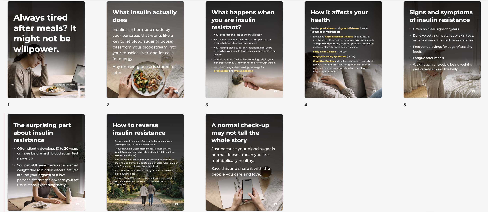
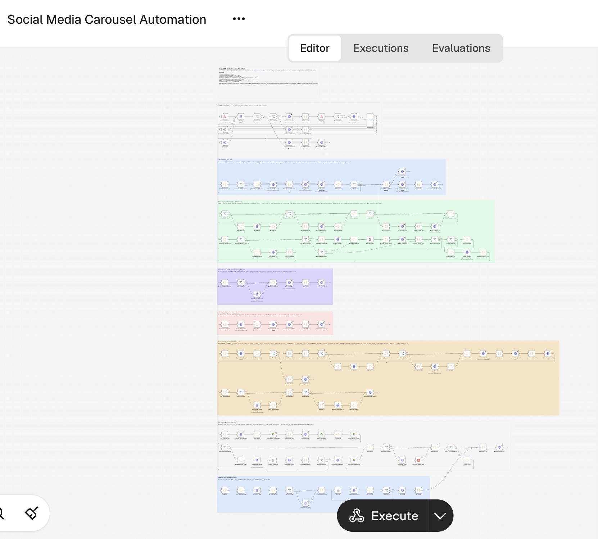
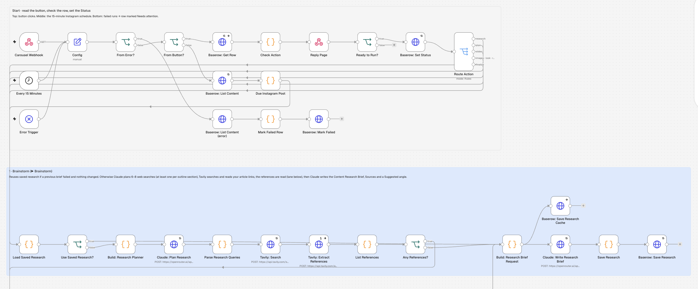
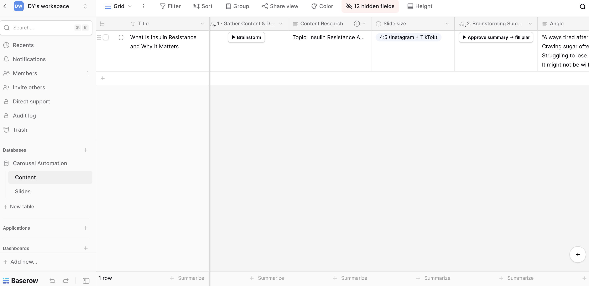
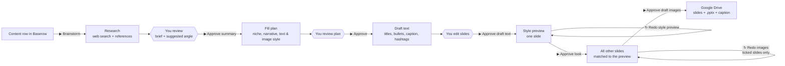
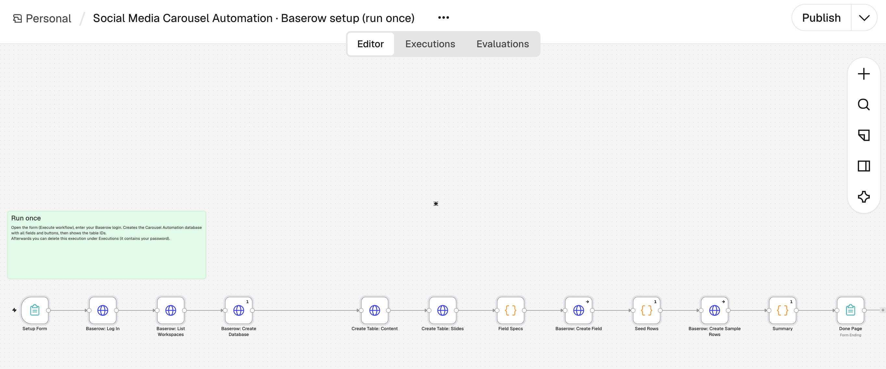

# Social Media Carousel Automation

**From a topic and a few reference links to a researched, designed, ready-to-post carousel.**

An n8n + Baserow automation that makes Instagram and TikTok carousels. A person approves every step from a Baserow table.

You fill in one row: a topic, an audience, an optional outline and some reference links. The workflow:
- researches the web and every reference you gave it (articles, YouTube, Instagram/TikTok posts, PDFs, audio, video);
- writes a sourced brief;
- plans the post;
- drafts the slide copy;
- generates one consistent set of slide art;
- saves everything, including an **editable .pptx**, to Google Drive.

Nothing moves on until you press the next button, so you can review and edit at every stage.


*A finished 8-slide carousel. The text is laid over text-free art in an editable .pptx.*

| The workflow: 153 nodes, one lane per button | Close-up: start and Brainstorm lanes |
|---|---|
|  |  |


*The Content table in Baserow. Each step is a button in the row.*

## How it works



Each button in Baserow is a formula field that opens the workflow's webhook with `?action=<step>&row=<id>`.

| # | Button | `action` | What the workflow does |
|---|---|---|---|
| 1 | ▶ Brainstorm | `research` | Claude plans 6–8 web searches (at least one per outline section), Tavily searches and reads the pages, every reference is summarised, and Claude writes the **Content Research Brief**, **Sources** and a suggested **Angle** |
| 2 | ▶ Approve summary → fill plan | `plan` | Reads an optional text-style reference image, then fills the empty fields: Niche, Narrative prompt, Format prompt, Text style and Image style |
| 3 | ▶ Approve → create draft text | `slides` | Writes each slide's Title, Body text and image prompt, plus the caption and hashtags. Replaces this row's old slide rows |
| 4 | ▶ Approve draft text → make style preview | `images` | Draws one style-preview slide, so you approve the look before paying for the full set |
| 5 | ▶ Approve look → make the other slides | `look` | Draws every other slide, using the approved preview as the style anchor |
| ↻ | ↻ Redo style preview / ↻ Redo images | `images` / `redo` | Redraws the preview, or only the slides ticked **Redo** (with an optional per-slide note and reference image) |
| 6 | ▶ Approve draft images | `finalize` | Builds the editable .pptx, then creates a Drive folder with every slide, the .pptx and `caption.txt` |

## Design decisions

- **A person approves every step.** Every stage writes into ordinary Baserow fields that you can edit before the next button reads them. Approving the style first means only one image is paid for until you're happy with the look.
- **Text-free art plus an editable .pptx.** Image models still misspell words and drift between slides. The art is generated without text, and the copy is laid over it in a PowerPoint/Keynote file built from scratch in plain JavaScript (`src/pptx-lib.js`, no libraries). Typos are fixed in seconds.
- **One look per set.** Each set uses a single medium (photo, illustration *or* typographic art). Slides after the preview are drawn with it as a style anchor. A vision check flags slides whose text area isn't dark enough for light text (or light enough for dark text).
- **A copy standard written into the prompts.** Titles are searchable keyword titles, never teasers. Bullets are mechanism-level and specific, with numbers and units. Facts come only from the research and the references, never from model memory. Gaps are flagged as "Not covered by the sources".
- **Cheapest reader per reference type, with backups:**

  | Source | Reader |
  |---|---|
  | Articles | Tavily, then a raw page reader |
  | YouTube | Gemini watches the video; Scrape Creators fetches a transcript only if Gemini fails |
  | Instagram/TikTok posts | Scrape Creators, then Qwen/Gemini on the media |
  | Audio | Gemini |
  | PDFs | Gemini Flash Lite reads the pages (scans, charts, tables); DeepSeek on the text layer as backup |
  | Long .txt / transcripts | Notes by Gemini Flash Lite (documents) or DeepSeek (transcripts) |

- **Failures you can recover from.** Research is cached, so a failed brief is rewritten without searching again. The workflow is its own error workflow: a crashed run marks its row **Needs attention**, matched by the n8n run id.
- **Field names can change.** Fields are matched by name (case- and space-insensitive), with an alias map, so renaming a column in Baserow doesn't break the workflow.
- **Readable canvas.** 153 nodes are laid out in one lane per button, top to bottom in the order you press them, each with a note explaining it (`layout.js`).

## Stack

| | |
|---|---|
| Orchestration | n8n (self-hosted, Docker): webhooks, Code nodes, HTTP Request |
| Database / UI | Baserow (self-hosted): two tables, Content and Slides |
| Writing | Claude Sonnet via OpenRouter |
| Research | Tavily search and extract, Scrape Creators |
| Media reading | Gemini Flash, Gemini Flash Lite, Qwen Omni and DeepSeek via OpenRouter |
| Images | Nano Banana (Gemini image) via OpenRouter |
| Output | Google Drive. Optional: Creatomate slideshow MP4, YouTube Shorts and Instagram Graph API posting (off by default) |

## Repository layout

```
carousel-automation.n8n.json        main workflow (export of the running version)
carousel-automation-setup.n8n.json  one-time workflow that creates the Baserow database, fields and buttons
baserow/schema.json            field layout of both tables (no data)
build.js                       generates both workflow files from src/
layout.js                      canvas layout and notes for the main workflow
src/                           the JavaScript inside each Code node (helpers.js and pptx-lib.js are shared)
test/dry-run.js                offline test suite: runs the real node code against fake API responses
docs/                          how to write the Content Research field
tools/n8n_api.py               n8n API helper: download, back up, upload or import the workflow (dry run unless --go)
CLAUDE.md                      build-from-scratch guide and project rules, for an AI coding agent or a developer
```

## Baserow tables

**Content** (one row per post). These are the fields you fill in or review. The full list is in [`baserow/schema.json`](baserow/schema.json).

| Field | Filled by | Purpose |
|---|---|---|
| Title, Content Research | you | Topic, audience, goal, optional outline ([guide](docs/how-to-write-content-research.md)) |
| Content Research Reference Links / Files | you | Articles, videos, posts, PDFs, audio |
| Angle, Style Direction | you (optional) | Hook to aim the research at; voice and look |
| Content Research Brief, Sources | Brainstorm | Sourced summary with key points per outline section |
| Niche, Narrative prompt, Format prompt, Text style, Image style | fill plan | The post's plan (edit before drafting) |
| Slide size, Slide count, reference images, Handle / series label | you or the plan | Format, look references, your handle on each slide |
| Slides, Post caption, Hashtags | draft text | Linked slide rows and the post copy |
| Editable slides, Drive folder | images / save | The .pptx and the finished post folder |
| Status, n8n run, Posting log | workflow | Progress, run id for error matching, notes |

**Slides** (one row per slide, linked to its Content row): Slide #, Role (cover/body/cta), Title, Body text, Image prompt, Image, Redo.

## Setup

1. **Run n8n and Baserow** in Docker, for example n8n on `localhost:5678` and Baserow on `localhost:85`. Start Baserow with `BASEROW_EXTRA_PUBLIC_URLS=http://host.docker.internal:85` so n8n can reach it from inside Docker.
2. **Import `carousel-automation-setup.n8n.json`** into n8n and run its form with your Baserow login. It creates the database, both tables, every field and button, and an example row. Its Summary node shows the table IDs and select-option IDs.

   
3. **Import `carousel-automation.n8n.json`.** In the **Config** node, set `contentTableId`, `slidesTableId` and `selectOptions` from step 2, and `driveFolderId` for your Google Drive folder.
4. **Create the credentials.** The nodes refer to them by these names:

   | Name | Type | Used for |
   |---|---|---|
   | Baserow | Header Auth, `Authorization: Token <database token>` | always |
   | OpenRouter | Header Auth, `Authorization: Bearer <key>` | always |
   | Tavily | Header Auth, `Authorization: Bearer <key>` | Brainstorm |
   | Scrape Creators | Header Auth, `x-api-key: <key>` | Instagram, TikTok and YouTube references |
   | Google Drive account | Google Drive OAuth2 | saving the post |
   | Creatomate, YouTube account, Magica | various | optional (slideshow video, Shorts upload, backup readers) |

5. **Activate the workflow** and press **▶ Brainstorm** on the example row.

API keys live only in n8n's credential store. The workflow file holds credential *names* only. See `.env.example` for the values the local scripts expect.

## Development

```
node build.js        # regenerate both workflow files from src/ and layout.js
node test/dry-run.js # offline test suite, makes no API calls
```

`carousel-automation.n8n.json` in this repo is an export of the running workflow. `node build.js` rewrites it with a version generated from `src/` that passes the same tests.

The dry run loads the workflow JSON and executes each Code node's real JavaScript in order, with canned responses for the Baserow, Claude, Tavily and image APIs. It checks:
- routing for every button;
- the Status changes;
- reference parsing and model fallbacks;
- outline coverage;
- slide-count limits;
- the .pptx output;
- error marking.
